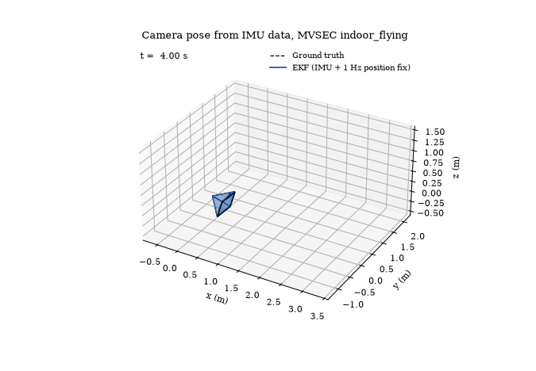
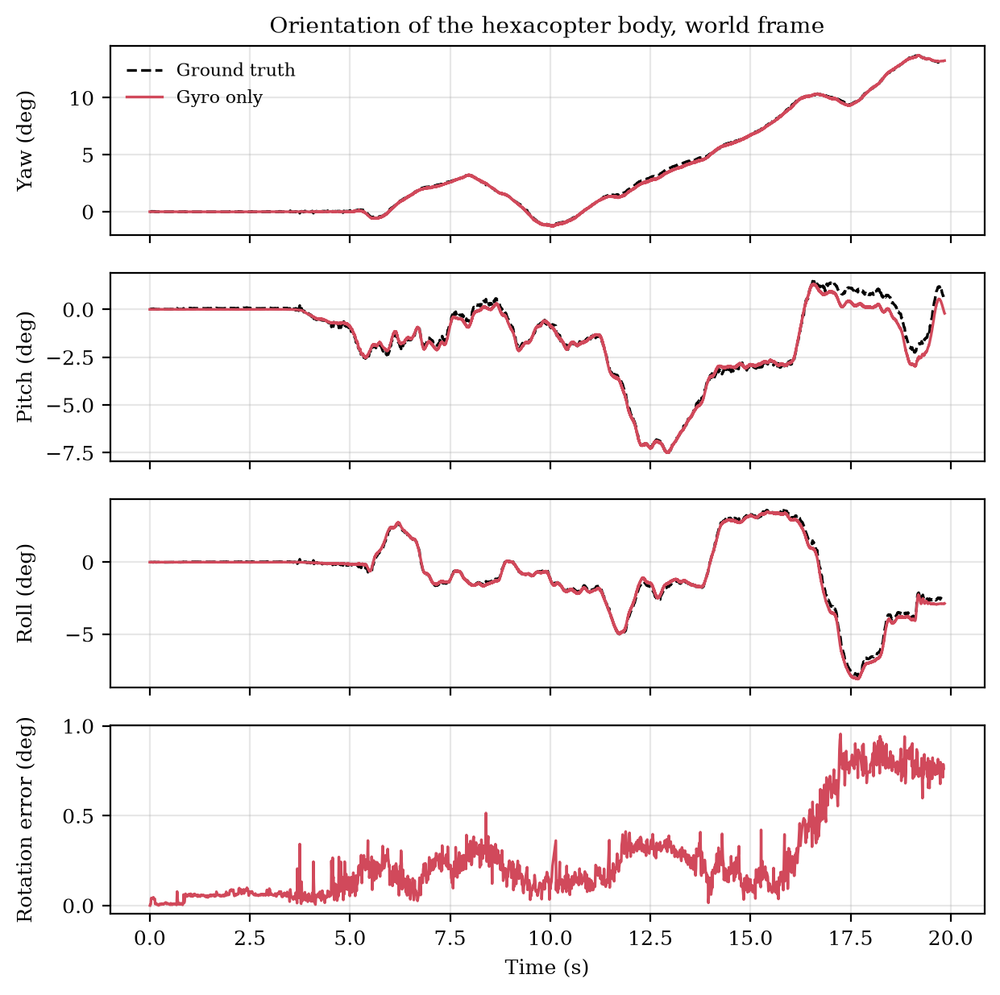
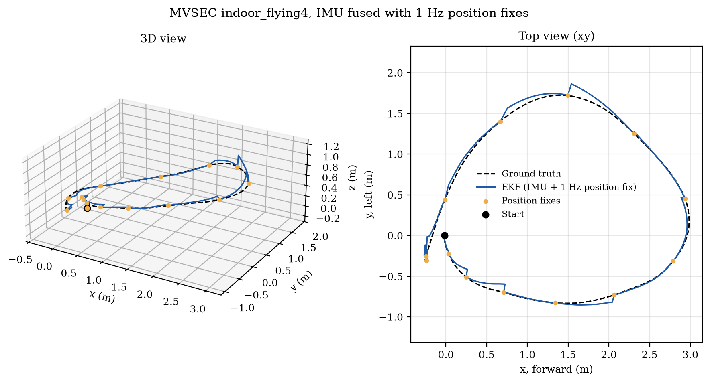
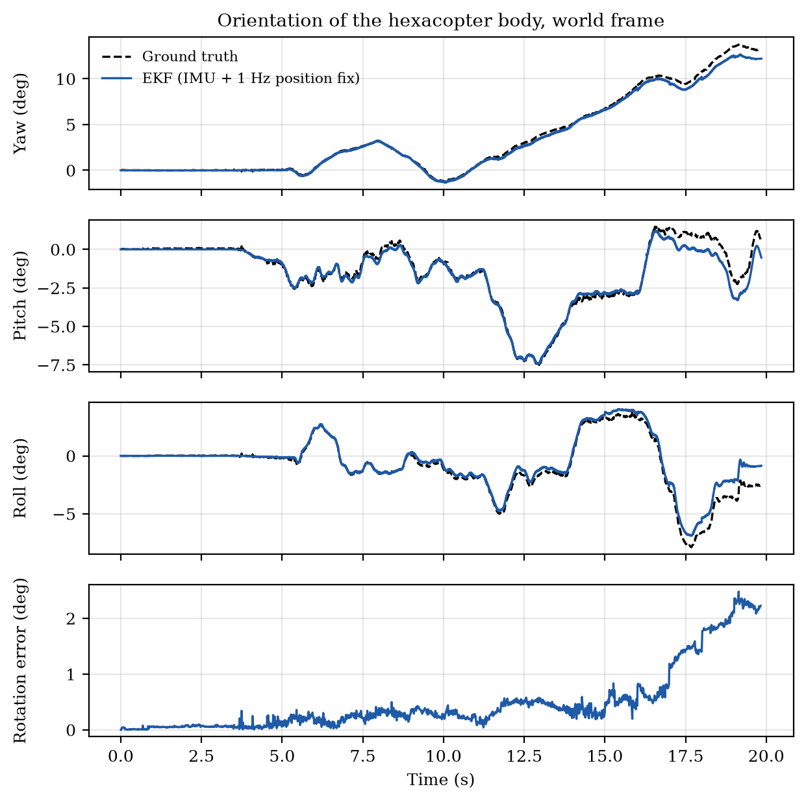

# IMU Trajectory Estimation on MVSEC



*The blue frustum is the EKF estimate of the camera pose and the dashed frustum is the ground truth. Each frustum is the pyramid of space the camera sees, so it points where the camera faces. The black triangle marks the top of the image.*

This project reconstructs the motion of the MVSEC hexacopter from its 1 kHz inertial measurement unit (IMU) and compares the result with motion-capture ground truth. Orientation comes from integrating the gyroscope. Position comes from integrating the accelerometer twice, first on its own and then inside an error-state Kalman filter (EKF) that receives one position fix per second.

The main result is a contrast. Over the 20 s `indoor_flying4` flight, the gyro alone tracks orientation to within 1 degree, while the accelerometer alone drifts by 11 m. One position fix per second is enough to bring the position error down to 6.6 cm RMSE.

## Results

All errors are measured against the ground truth at its 85 Hz timestamps (Figures 3 to 5).

| Method | Position RMSE | Max position error | Mean rotation error | Max rotation error |
|---|---|---|---|---|
| Gyro only (orientation) | n/a | n/a | 0.26° | 0.96° |
| IMU only (dead reckoning) | 4.42 m | 13.19 m | 0.26° | 0.96° |
| EKF, IMU + 1 Hz position fix | 0.066 m | 0.25 m | 0.48° | 2.48° |

Dead-reckoning position error grows from 0.15 m at t = 7 s to 0.89 m at 10 s and 11.06 m at 19 s. The take-off happens at about t = 5.5 s. This quadratic growth is expected. An attitude error of 1 degree tilts 0.17 m/s² of gravity into the horizontal, which alone becomes 34 m after 20 s of double integration.

The EKF has a slightly larger rotation error than the gyro alone. A position fix carries only indirect information about attitude, so part of each correction leaks into the attitude estimate through the noisy, vibration-heavy accelerometer. A filter that also received an orientation measurement would not have this problem.

## Figures

**Figure 1.** Raw IMU measurements. The shaded window is the first 3 s, when the hexacopter rests on the floor and the biases are estimated.


**Figure 2.** Yaw, pitch, and roll from gyro integration (red) against ground truth (dashed). The bottom panel is the rotation error.



**Figure 3.** Trajectory from the EKF (blue) against ground truth (dashed), with the 1 Hz position fixes in orange. The small jumps are the corrections applied when each fix arrives.



**Figure 4.** Position per axis for dead reckoning (red) and the EKF (blue). The bottom panel shows the position error on a log scale, with vertical lines at the fix times.


**Figure 5.** Orientation from the EKF against ground truth.



## Method

**Data.** The [MVSEC](https://daniilidis-group.github.io/mvsec/) `indoor_flying4` sequence was recorded on a hexacopter carrying a DAVIS 346 event camera with a built-in IMU. The IMU runs at 1 kHz. The ground truth is the left camera pose from a motion-capture system at about 85 Hz.

**Bias estimation.** The hexacopter is still for the first 3.5 s. The mean gyro reading over the first 3 s is taken as the gyro bias. The accelerometer reads 8.77 m/s² at rest instead of 9.81 m/s², so the bias along gravity is also removed. The horizontal accelerometer bias cannot be observed at rest and is left to the EKF.

**World frame.** MVSEC expresses the ground truth in the first camera frame, which points 16.9° below the horizon. The project uses a gravity-aligned world frame instead, with z up, x along the camera's initial heading projected onto the floor, and y to the left. Gravity fixes roll and pitch. Yaw cannot be observed from an IMU, so the initial heading defines it. The ground truth is rotated into the same frame and shifted by the 1.8 cm lever arm between the camera and the IMU.

**Time alignment.** The ground-truth clock lags the IMU by 57.5 ms. The offset is found by sliding the ground-truth angular velocity over the gyro signal and keeping the shift with the smallest mismatch. Without this step the maximum gyro rotation error rises from 0.96° to 1.8°.

**Gyro integration.** Each gyro sample, minus the bias, is turned into a small rotation with Rodrigues' formula and multiplied onto the current orientation.

**Dead reckoning.** Each accelerometer sample is rotated into the world frame, gravity is added back, and the result is integrated into velocity and then position.

**Error-state EKF.** The prediction step is the same strapdown integration. The filter also propagates the covariance of a 15-dimensional error state (position, velocity, attitude, accelerometer bias, and gyro bias) using the linearised error dynamics from Solà (2017). Once per second, a position fix taken from the ground truth corrects the state. The fix stands in for a GPS receiver, a motion-capture system, or a visual odometry front end. The accelerometer noise is set to 3 m/s², about ten times the value measured at rest, because propeller vibration dominates in flight. With the at-rest value, the maximum rotation error rose from 2.5° to 7.2°.

## Running it

```bash
conda activate ml
pip install -r requirements.txt
```

Download `indoor_flying4_data.bag` and `indoor_flying4_gt.bag` from the [MVSEC website](https://daniilidis-group.github.io/mvsec/download/), set `DATA_DIR` at the top of each notebook, and run the notebooks in order. The first run caches the IMU and ground truth in `data/indoor_flying4.npz`, so the 1.2 GB bags are read only once. The other `indoor_flying` sequences should work by changing `SEQUENCE_NAME`, but only `indoor_flying4` has been tested.

```
calibration/   camera-IMU calibration for the indoor_flying sequences
imu_tracking/
    data.py         bag reading, bias estimation, world frame, time offset
    integration.py  gyro integration and dead reckoning
    ekf.py          error-state Kalman filter with position fixes
    evaluation.py   error metrics and Euler angles
    plots.py        figures and the camera frustum animation
notebooks/
    01_orientation_from_gyro.ipynb
    02_position_and_ekf.ipynb
figures/       outputs used in this README
```

## Limitations

The position fixes come from the ground truth itself, so the EKF result shows what an IMU can do with a perfect 1 Hz external sensor. It is not a standalone navigation system. The sequence is also short. Twenty seconds is enough to show the drift, but not enough to test bias estimation over a long flight. Replacing the ground-truth fixes with visual odometry from the event camera is the natural next step.

## References

1. A. Z. Zhu, D. Thakur, T. Özaslan, B. Pfrommer, V. Kumar, and K. Daniilidis. "The Multivehicle Stereo Event Camera Dataset: An Event Camera Dataset for 3D Perception." *IEEE Robotics and Automation Letters*, 2018.
2. J. Solà. "Quaternion kinematics for the error-state Kalman filter." arXiv:1711.02508, 2017.
3. S. O. H. Madgwick. Gait tracking with x-IMU, MATLAB `SixDofAnimation`, x-io Technologies. The animation in this project follows its layout.
4. M. Grupp. evo, a Python package for the evaluation of odometry and SLAM. The trajectory figures follow its overlay style.

## License

Code in this repository is licensed under the [MIT License](LICENSE).

The calibration file in `calibration/` and the figures in `figures/` and in the notebook outputs are
adapted from the [MVSEC dataset](https://daniilidis-group.github.io/mvsec/) and are distributed under
[CC BY-SA 4.0](https://creativecommons.org/licenses/by-sa/4.0/).

The attribution, source, and modification notice for these assets is in [ATTRIBUTION.md](ATTRIBUTION.md).
