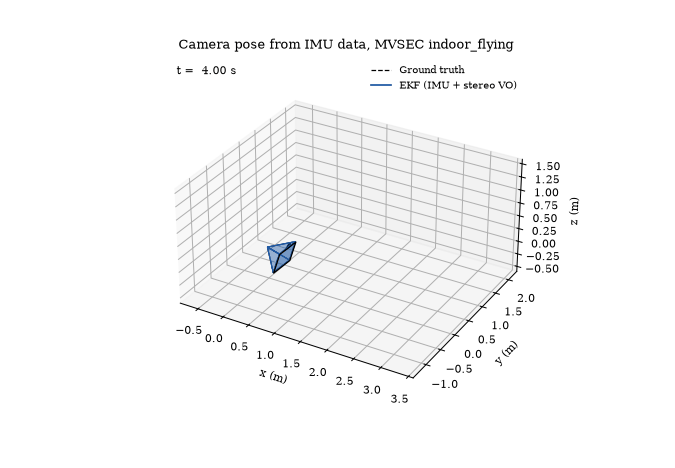
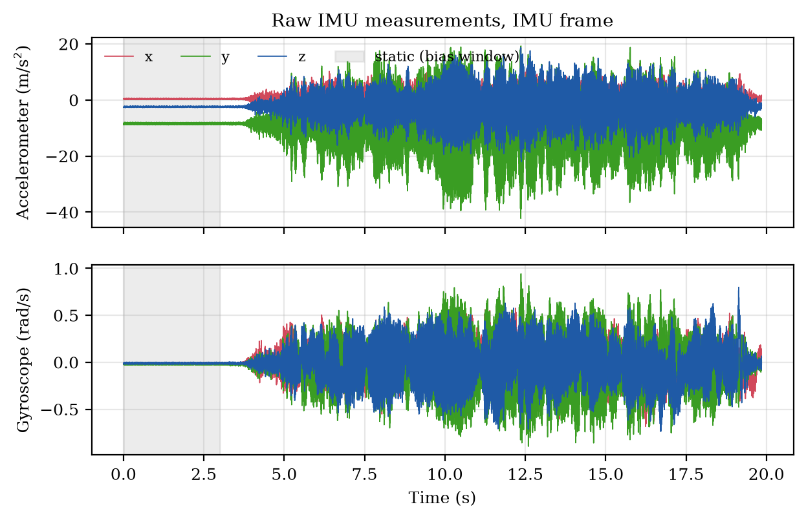
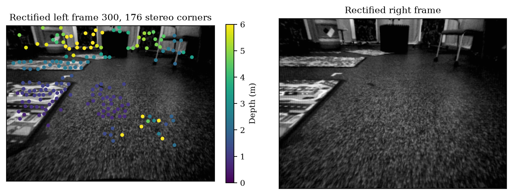
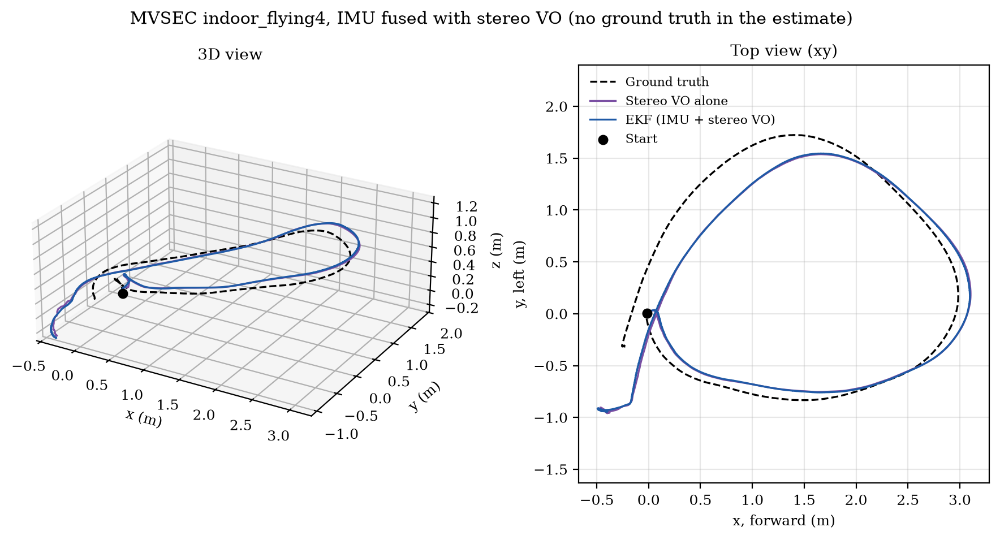
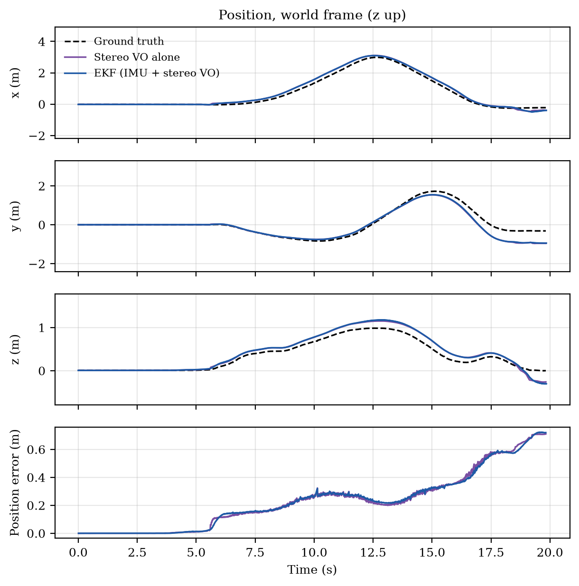
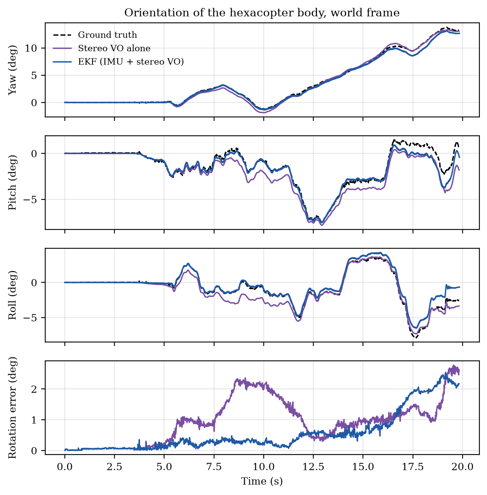
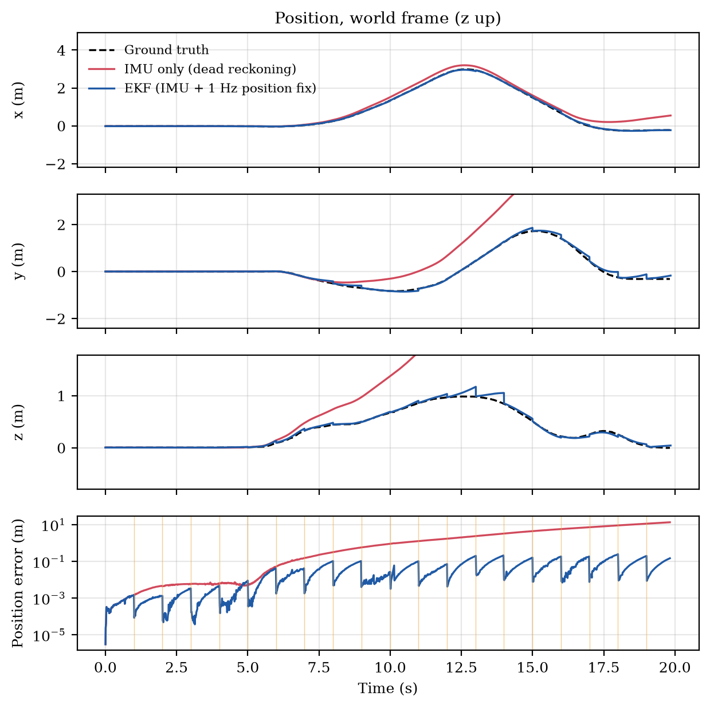

# IMU Trajectory Estimation on MVSEC



*The blue frustum is the camera pose estimated from the IMU and the two DAVIS cameras, with no ground truth in the estimate. The dashed frustum is the motion-capture ground truth. Each frustum is the pyramid of space the camera sees, so it points where the camera faces. The black triangle marks the top of the image.*

This project reconstructs the motion of the MVSEC hexacopter from its 1 kHz inertial measurement unit (IMU) and its stereo DAVIS cameras, and compares the result with motion-capture ground truth. It builds up in three steps. The gyroscope alone gives orientation. The accelerometer alone gives position, which drifts quickly. Stereo visual odometry (VO) from the camera frames then supplies metric position, and an error-state Kalman filter (EKF) fuses it with the IMU.

Over the 20 s `indoor_flying4` flight, the gyro tracks orientation to within 1 degree while the accelerometer alone drifts by 13 m by the end of the flight. With stereo VO and no ground truth in the estimate, the position error is 0.30 m RMSE and the final drift is 7.3% of the 9.8 m path. For comparison, the same EKF fed with one ground-truth position per second reaches 0.066 m, which marks an upper bound for this filter.

## Results

All errors are measured against the ground truth at its 85 Hz timestamps. The ground truth is used only for this scoring and for the figures, except in the last row, where it also supplies the position fixes.

| Method | Uses ground truth | Position RMSE | Final position error | Mean rotation error | Max rotation error |
|---|---|---|---|---|---|
| Gyro only (orientation) | no | n/a | n/a | 0.26° | 0.96° |
| IMU only (dead reckoning) | no | 4.42 m | 13.2 m | 0.26° | 0.96° |
| Stereo VO alone | no | 0.30 m | 0.71 m | 0.92° | 2.77° |
| **EKF, IMU + stereo VO** | **no** | **0.30 m** | **0.72 m** | **0.56°** | **2.54°** |
| EKF, IMU + 1 Hz ground-truth fix | yes (upper bound) | 0.066 m | 0.15 m | 0.48° | 2.48° |

**IMU alone.** Dead-reckoning error grows from 0.15 m at t = 7 s to 0.89 m at 10 s and 13.2 m at the end of the flight, with take-off at about t = 5.5 s. This quadratic growth is expected. An attitude error of 1 degree tilts 0.17 m/s² of gravity into the horizontal, which alone becomes 34 m after 20 s of double integration.

**IMU with stereo VO.** Stereo VO never lost tracking and kept at least 27 PnP inliers in every frame. Fusing it with the IMU improves orientation from 0.92° to 0.56° mean error but leaves position almost unchanged. The VO positions are chained frame to frame, so their errors carry over in time and the filter has no independent reference to remove them. The IMU contributes a more accurate orientation and a pose at 1 kHz instead of 31 Hz. About 0.1 m of the error appears in a single step at take-off, and the rest accumulates slowly, mostly in height and in the sideways direction.

**IMU with ground-truth fixes.** This row shows what the filter can do with a perfect external position sensor. Its rotation error is slightly larger than the gyro alone because a position fix carries only indirect information about attitude, and part of each correction leaks into the attitude estimate through the vibration-heavy accelerometer.

## Figures

**Figure 1.** Raw IMU measurements. The shaded window is the first 3 s, when the hexacopter rests on the floor and the biases are estimated.



**Figure 2.** Yaw, pitch, and roll from gyro integration (red) against ground truth (dashed). The bottom panel is the rotation error.


**Figure 3.** A rectified stereo pair at frame 300. Each dot is a corner matched between the left and right images, coloured by the depth computed from its disparity. Most floor corners sit at 1 to 2 m, and a few on the repetitive carpet texture are mismatched and placed near 6 m.



**Figure 4.** Trajectory from stereo VO (purple) and from the EKF that fuses it with the IMU (blue), against ground truth (dashed). The two estimates overlap almost everywhere.



**Figure 5.** Position per axis for stereo VO and the EKF. The bottom panel is the position error, with the step at take-off near t = 5.6 s.



**Figure 6.** Orientation from stereo VO and from the EKF. The gyro removes most of the VO rotation error.



**Figure 7.** Upper bound. The EKF fed with one ground-truth position per second (orange dots). The small jumps are the corrections applied when each fix arrives.


**Figure 8.** Position per axis for dead reckoning (red) and the ground-truth-fix EKF (blue). The error panel uses a log scale and marks the fix times.



## Method

**Data.** The [MVSEC](https://daniilidis-group.github.io/mvsec/) `indoor_flying4` sequence was recorded on a hexacopter carrying a stereo pair of DAVIS 346 cameras with built-in IMUs. The project uses the left IMU at 1 kHz and the left and right grayscale frames at 31 Hz. The ground truth is the left camera pose from a motion-capture system at about 85 Hz.

**Bias estimation.** The hexacopter is still for the first 3.5 s. The mean gyro reading over the first 3 s is taken as the gyro bias. The accelerometer reads 8.77 m/s² at rest instead of 9.81 m/s², so the bias along gravity is also removed. The horizontal accelerometer bias cannot be observed at rest and is left to the EKF.

**World frame.** MVSEC expresses the ground truth in the first camera frame, which points 16.9° below the horizon. The project uses a gravity-aligned world frame instead, with z up, x along the camera's initial heading projected onto the floor, and y to the left. Gravity fixes roll and pitch. Yaw cannot be observed from an IMU, so the initial heading defines it. The ground truth is rotated into the same frame and shifted by the 1.8 cm lever arm between the camera and the IMU.

**Time alignment for evaluation.** The ground-truth clock lags the IMU by 57.5 ms. The offset is found by sliding the ground-truth angular velocity over the gyro signal and keeping the shift with the smallest mismatch. It only aligns the ground truth for scoring. Without it, the maximum gyro rotation error would read 1.8° instead of 0.96°.

**Gyro integration and dead reckoning.** Each gyro sample, minus the bias, is turned into a small rotation with Rodrigues' formula and multiplied onto the current orientation. Each accelerometer sample is rotated into the world frame, gravity is added back, and the result is integrated into velocity and then position.

**Stereo VO.** Both frames are undistorted with the equidistant lens model and rectified with the MVSEC calibration, which leaves a 9.99 cm baseline and a 199.7 px focal length. The frames are dark, so local contrast is boosted with CLAHE. In each left frame, up to 400 corners are detected and matched into the right frame with Lucas-Kanade optical flow. A match is kept if it stays within 1 px of the same row, and its depth is focal length times baseline divided by disparity. The corners are then tracked into the next left frame, and PnP with RANSAC gives the camera motion between the two frames. Chaining these motions gives the trajectory in metres without any ground truth.

**Error-state EKF.** The prediction step is the same strapdown integration as dead reckoning. The filter also propagates the covariance of a 15-dimensional error state (position, velocity, attitude, accelerometer bias, and gyro bias) using the linearised error dynamics from Solà (2017). Each position measurement corrects the state. In notebook 03 the measurements are the VO positions at 31 Hz with a 5 cm standard deviation. In notebook 02 they are ground-truth positions at 1 Hz with a 2 cm standard deviation. The accelerometer noise is set to 3 m/s², about ten times the value measured at rest, because propeller vibration dominates in flight. With the at-rest value, the maximum rotation error of the ground-truth-fix filter rose from 2.5° to 7.2°.

## Running it

```bash
conda activate ml
pip install -r requirements.txt
```

Download `indoor_flying4_data.bag` and `indoor_flying4_gt.bag` from the [MVSEC website](https://daniilidis-group.github.io/mvsec/download/), set `DATA_DIR` at the top of each notebook, and run the notebooks in order. The first runs cache the IMU, ground truth, and stereo frames in `data/`, so the 1.2 GB of bags is read only once. The other `indoor_flying` sequences should work by changing `SEQUENCE_NAME`, but only `indoor_flying4` has been tested.

```
calibration/   camera-IMU and stereo calibration for the indoor_flying sequences
imu_tracking/
    data.py         bag reading, bias estimation, world frame, time offset
    integration.py  gyro integration and dead reckoning
    stereo_vo.py    stereo rectification, depth from disparity, frame-to-frame PnP
    ekf.py          error-state Kalman filter with position measurements
    evaluation.py   error metrics and Euler angles
    plots.py        figures and the camera frustum animation
notebooks/
    01_orientation_from_gyro.ipynb
    02_position_and_ekf.ipynb
    03_stereo_vio.ipynb
figures/       outputs used in this README
```

## Limitations

The stereo VO is frame to frame, so every small error is kept forever and the drift grows with distance. The left and right frames are exposed 14 ms apart, which biases depth whenever the camera moves sideways. The filter is loosely coupled, meaning it fuses VO positions rather than the feature tracks themselves, so it cannot use the IMU to reject bad visual measurements. Keyframe-based tracking and a tightly coupled filter such as the MSCKF are the standard fixes. The VO also uses the DAVIS grayscale frames, not its events. An event-based front end is a separate and harder problem. Finally, the sequence is 20 s long, which is enough to show drift but not to test long-term bias estimation.

## References

1. A. Z. Zhu, D. Thakur, T. Özaslan, B. Pfrommer, V. Kumar, and K. Daniilidis. "The Multivehicle Stereo Event Camera Dataset: An Event Camera Dataset for 3D Perception." *IEEE Robotics and Automation Letters*, 2018.
2. J. Solà. "Quaternion kinematics for the error-state Kalman filter." arXiv:1711.02508, 2017.
3. A. I. Mourikis and S. I. Roumeliotis. "A Multi-State Constraint Kalman Filter for Vision-aided Inertial Navigation." *IEEE International Conference on Robotics and Automation*, 2007.
4. S. O. H. Madgwick. Gait tracking with x-IMU, MATLAB `SixDofAnimation`, x-io Technologies. The animation in this project follows its layout.
5. M. Grupp. evo, a Python package for the evaluation of odometry and SLAM. The trajectory figures follow its overlay style.

## License

Code in this repository is licensed under the [MIT License](LICENSE).

The calibration file in `calibration/` and the figures in `figures/` and in the notebook outputs are
adapted from the [MVSEC dataset](https://daniilidis-group.github.io/mvsec/) and are distributed under
[CC BY-SA 4.0](https://creativecommons.org/licenses/by-sa/4.0/).

The attribution, source, and modification notice for these assets is in [ATTRIBUTION.md](ATTRIBUTION.md).
